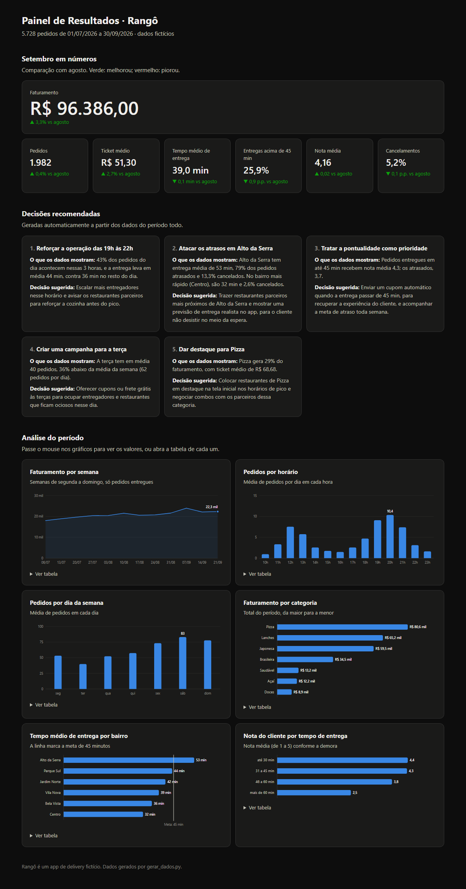

# Painel de Resultados de Vendas

Dashboard que organiza os dados de pedidos de um app de delivery, mostra os principais **indicadores** e **gráficos** e transforma os números em **decisões recomendadas**. Ele é feito em Python, só com a biblioteca padrão, sem pandas nem matplotlib e sem instalar nada. O resultado é uma página HTML que abre em qualquer navegador.

> O **Rangô** é um app de delivery fictício, e todos os dados foram gerados por um script (`gerar_dados.py`).



## O problema

Uma operação de delivery gera milhares de pedidos por mês. Olhando a planilha, ninguém consegue responder rápido:

- O mês foi melhor ou pior que o anterior?
- Em que horário e em que dia a operação fica sobrecarregada ou ociosa?
- Em quais bairros as entregas atrasam e quanto isso custa em cancelamentos?
- O atraso afeta a satisfação do cliente?
- Quais categorias trazem mais dinheiro?

O painel responde essas perguntas em uma única página e sugere o que fazer a respeito.

## O que o painel mostra

**1. Indicadores do mês**, comparados com o mês anterior: faturamento, pedidos, ticket médio, tempo de entrega, entregas atrasadas, nota média e cancelamentos. A comparação aparece em verde quando o indicador melhorou e em vermelho quando piorou. Para tempo de entrega e cancelamentos, cair é bom.

**2. Decisões recomendadas**, geradas a partir dos dados (`painel/decisoes.py`). Cada uma mostra a evidência e a ação sugerida:

| Decisão | O que os dados mostram |
|---|---|
| Reforçar a operação das 19h às 22h | 43% dos pedidos do dia caem nessas 3 horas, e a entrega fica 8 min mais lenta |
| Atacar os atrasos no Alto da Serra | 53 min de entrega média, 79% de atrasos e 13,3% de cancelamentos (contra 2,6% no Centro) |
| Tratar a pontualidade como prioridade | Entregas no prazo têm nota 4,3; as atrasadas, 3,7 |
| Criar uma campanha para a terça | A terça tem 36% menos pedidos que a média da semana |
| Dar destaque para Pizza | Pizza gera 29% do faturamento, com ticket médio de R$ 68,68 |

As regras não são fixas no texto: elas **calculam** os números a cada execução. Com outros dados, as recomendações mudam. Se uma regra não encontra problema (por exemplo, nenhum bairro acima da meta), ela não gera recomendação.

**3. Gráficos do período:**

| Gráfico | Para que serve |
|---|---|
| Faturamento por semana (linha) | Ver a tendência de crescimento |
| Pedidos por horário (colunas) | Encontrar os picos de almoço e jantar |
| Pedidos por dia da semana (colunas) | Encontrar os dias fortes e fracos |
| Faturamento por categoria (barras) | Saber o que mais vende |
| Tempo de entrega por bairro (barras + meta) | Ver quais bairros passam da meta de 45 min |
| Nota por tempo de entrega (barras) | Mostrar que o atraso derruba a satisfação |

Ao passar o mouse sobre um gráfico, aparece o valor exato. Cada gráfico também tem um botão **"Ver tabela"** com os números. A página se adapta ao celular e ao modo escuro.

## Como rodar

Precisa só do Python 3.10 ou mais recente:

```bash
python3 gerar_dados.py             # (opcional) gera de novo os dados fictícios em dados/pedidos.csv
python3 main.py                    # cria saida/dashboard.html e mostra o resumo no terminal
python3 -m unittest discover -v    # testes automatizados
```

Depois, abra `saida/dashboard.html` no navegador (dois cliques no arquivo).

Para usar outros dados, basta um CSV com as mesmas colunas:

```bash
python3 main.py --dados meus_pedidos.csv --saida meu_painel.html
```

## Os dados

`dados/pedidos.csv` tem 5.728 pedidos de julho a setembro de 2026:

| Coluna | Exemplo |
|---|---|
| pedido | P00001 |
| data, hora | 2026-07-01, 19:42 |
| restaurante, categoria | Pizzaria Bella Massa, Pizza |
| bairro | Vila Nova |
| pagamento | Pix |
| valor | 68.90 |
| status | entregue ou cancelado |
| tempo_entrega_min | 38 (vazio se cancelado) |
| avaliacao | 1 a 5 (vazio se o cliente não avaliou) |

O gerador usa uma semente fixa, então os dados são sempre os mesmos. Ele embute padrões realistas para o painel ter o que descobrir: picos de horário, fim de semana mais forte, crescimento mês a mês, bairros mais distantes e mais lentos, e notas piores quando há atraso.

## Estrutura do projeto

| Arquivo | Responsabilidade |
|---|---|
| `main.py` | Lê os dados, mostra o resumo no terminal e salva o painel |
| `gerar_dados.py` | Gera os pedidos fictícios |
| `painel/leitura.py` | Lê e valida o CSV (avisa a linha com erro) |
| `painel/indicadores.py` | Calcula os indicadores e os agrupamentos (mês, semana, hora, bairro...) |
| `painel/decisoes.py` | Regras que transformam indicadores em recomendações |
| `painel/graficos.py` | Desenha os gráficos em SVG, sem bibliotecas |
| `painel/pagina.py` | Monta a página HTML (indicadores, decisões, gráficos, modo escuro) |
| `painel/formato.py` | Números no padrão brasileiro (R$ 1.234,56) |
| `tests/test_painel.py` | 18 testes automatizados |

## Decisões de design

- **Sem bibliotecas externas:** os gráficos são desenhados em SVG pelo próprio código. O projeto roda em qualquer computador com Python, sem instalar nada.
- **Uma cor por gráfico:** cada gráfico mostra uma única série, então todos usam o mesmo azul. Verde e vermelho ficam reservados para dizer se um indicador melhorou ou piorou e sempre vêm com uma seta (▲▼), para não depender só da cor.
- **Números no lugar certo:** os rótulos aparecem só onde ajudam (o maior valor, o fim da linha, a ponta das barras). O resto fica no balão do mouse e na tabela.
- **Modo claro e escuro** seguem a configuração do computador.

## Próximos passos

- Filtros por mês, bairro e categoria na própria página
- Ler os dados direto de um banco de dados em vez de um CSV
- Atualização automática diária (agendada)
- Publicar o painel online com GitHub Pages

## O que pratiquei

- Organização e agregação de dados com a biblioteca padrão (`csv`, `collections`, `datetime`, `dataclasses`)
- Definição de indicadores de negócio (ticket médio, taxa de cancelamento, meta de entrega)
- Visualização de dados: escolha do tipo de gráfico, escalas, rótulos e acessibilidade
- Geração de HTML, CSS e SVG a partir do Python
- Transformação de dados em recomendações de negócio
- Testes automatizados com `unittest`
